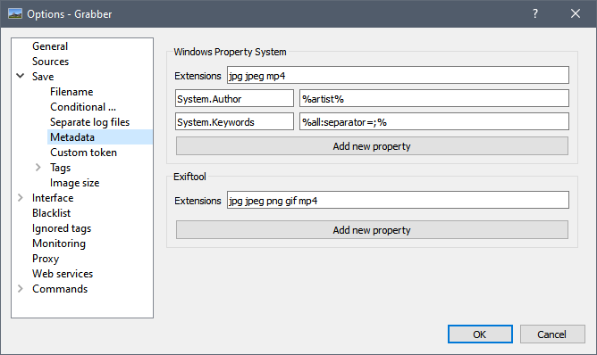
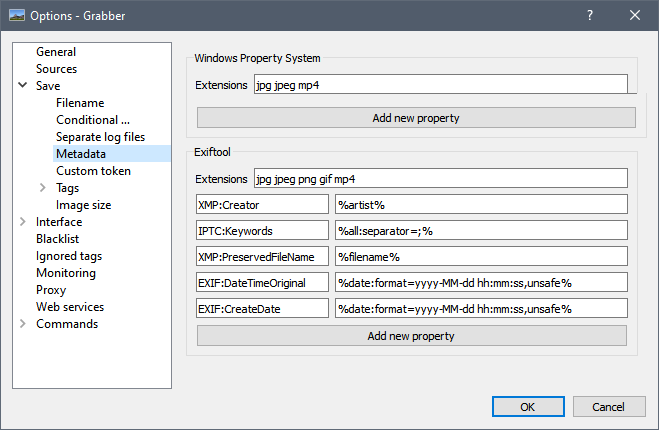

## Introduction

You might want to store a post's information not in the downloaded file's filename, but instead inside its metadata. This usually allows better searching, and avoid filesystem filename length limits.

## Windows Property System

Only available on Windows due to the nature of those properties.

Only available on a few extensions by default (JPG / MP4, not PNG / GIF / WEBM). If you want this to work on every extension, you should use something like [FileMeta](https://github.com/Dijji/FileMeta).

Example of commonly used property names (non-exhaustive):

* System.Author
* System.Keywords
* System.Comment

The full list can be found here:  
<https://docs.microsoft.com/en-us/windows/win32/properties/props>

Here's a basic example of what is possible to do:

## Exiftool

You first need to download Exiftool and put it in a place where Grabber can find it. Either in your PATH or in the installation folder.

Only available on extensions supported by Exiftool. Note that even with this name, Exiftool does not only support EXIF, but also IPTC, XMP, and ICC, as well as some others format-dependent options.

Example of commonly used property names (non-exhaustive):

* IPTC.Keywords
* XMP.Creator

The full list can be found here:  
<https://exiftool.org/#supported>

Note that you don't necessarily need to put the IPTC/XMP prefix, as Exiftool will find it automatically (checking in this order: EXIF, IPTC, XMP).

Here's a basic example of what is possible to do:

### Sidecar files

The sidecar file settings allows you to control whether Grabber will write to XMP sidecar files or not. There are a few options:

* **Disabled**: will not write any sidecar files
* **On error**: will write the sidecar files if the program failed to write to the original file (useful for file formats that do not support metadata)
* **Both sidecar and original**: will write to both the original file and the sidecar file
* **Only sidecar**: will only write to the sidecar file, without touching the original file

By default, Grabber will use your filename to generate the sidecar file, appending the XMP extension to it. So for example, `image.jpg` will have a sidecar file called `image.jpg.xmp`. Some other programs prefer the `image.xmp` format (without the original extension), so you can check the "Do not include original extension in sidecar file names" setting if you prefer that format.

## Updating metadata of existing files

By default, files that already exist are skipped. If you check "Update the metadata of files that already exist", Grabber will instead load the latest details of the post and write its metadata again (Windows properties, Exiftool and XMP sidecar files), without downloading the file again. This applies both to files that exist at the destination and to files found elsewhere with the MD5 "ignore" setting.

Since tags mostly change shortly after a post is uploaded, you can limit this to posts younger than a given number of days, so that re-running a download only updates recent posts. The post date is used. If the post has none, the oldest post date of the other websites the file was found on is used (see [Metadata database](#metadata-database)), and otherwise the file's modification date. Set it to "No limit" to update all existing files.

Updating metadata does not change the dates of the file: they are set again according to the "File date" setting (see [File date](#file-date)), or back to their previous value if it is "Download date". With "Original date", the file date can become older if the file was found on a website where it was posted earlier.

If you also enabled the [metadata database](#metadata-database), you can check "Only once per website" so that each post is only fetched once: files whose metadata was already stored for the current website and post ID are skipped, without loading their details. For example, an image downloaded from Danbooru then found on Gelbooru will have its metadata updated once with Gelbooru's tags, then skipped on both websites afterwards.

Note that this does not run commands or write log files again.

## Metadata database

If you check "Keep a database of the metadata of all the sources of each file", Grabber will store the tags of every file it saves or updates in a `metadata.sqlite` file in your profile folder. Files are identified by their MD5, so the same file found on several websites will have one row per website.

This allows using tokens that combine the information of all the websites a file was found on, which is mostly useful in metadata:

* `%websites%`, `%websiteids%` and `%websitenames%` list all the websites the file was found on.
* `%merged_all%`, `%merged_artist%`, `%merged_character%`, etc. combine the tags of all those websites.
* `%merged_date%` is the oldest post date of all those websites.

For example, downloading the same image from Danbooru then Gelbooru with the Exiftool property `XMP:Subject` set to `%merged_all%` will write the tags of both websites in the second file's metadata.

The `metadata` table contains the following columns: `md5`, `website`, `website_name`, `item` (the image ID on that website), `rating`, `date` (the post date on that website, in ISO 8601 UTC), `artist`, `copyright`, `character`, `model`, `species`, `meta`, `general`, `tags` (all tags) and `updated_at`. Tag columns are stored as JSON arrays.

## File date

The "File date" setting (in the "Save" settings) decides which date is given to saved files:

* **Source date**: the post date on the website the file is downloaded from.
* **Original date**: the oldest post date of all the websites the file was found on. This requires the metadata database, otherwise it is the same as the source date.
* **Download date**: the date of the file is not changed.

If a date is missing, the next one in this list is used. For example, a file downloaded from a website that doesn't provide post dates will still get a date if it was found on another website that does.
